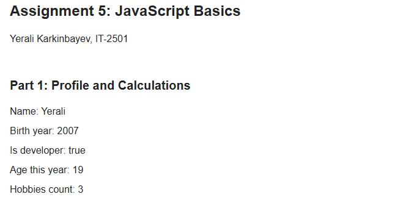
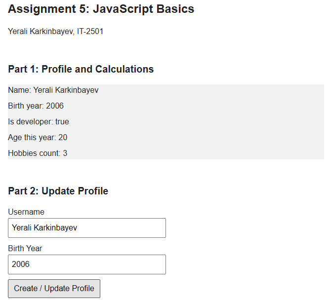
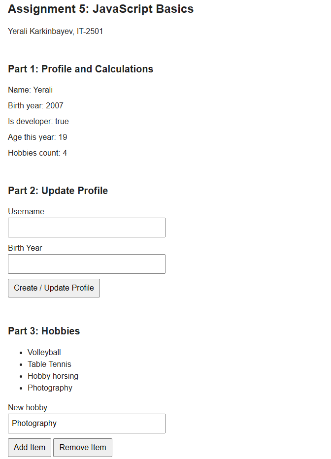
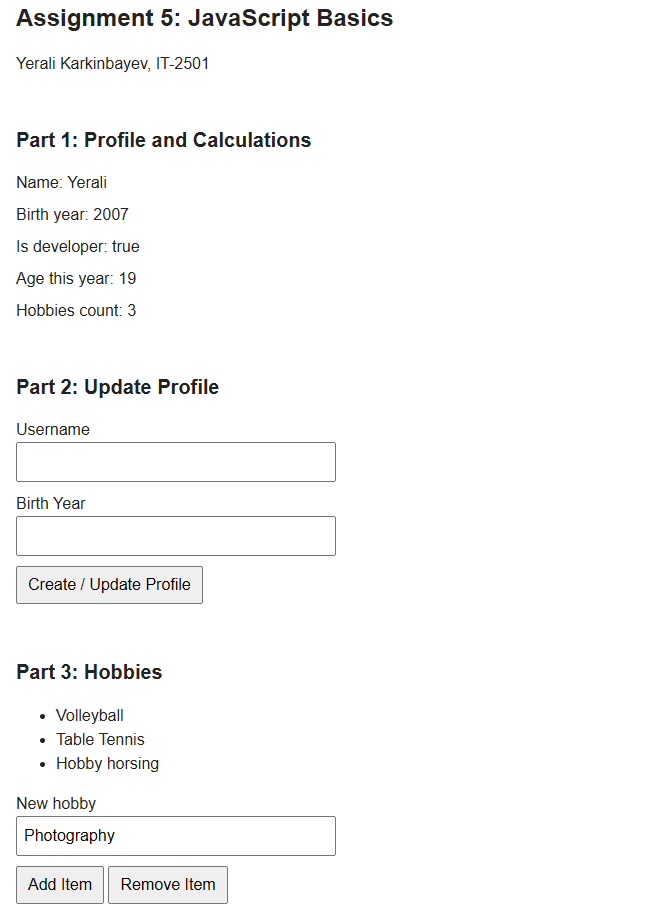

# Assignment 5: JavaScript Basics

**Name:** Yerali Karkinbayev

**Group:** IT-2501

## Part 1: Profile Object, Data Types and Arithmetic

### Task 1. User Profile Object

My profile is stored in a const object called userProfile. It has a string, a number, a boolean and an array of hobbies.

### Task 2. Arithmetic Calculations

The script subtracts the birth year from the current year and counts the hobbies. Both results appear on the page and in the console.

## Part 2: Form Input and Event Responses

### Task 3. HTML Form

I added Username and Birth Year fields with a Create / Update Profile button.

### Task 4. Event Listener

The submit event reads the inputs and updates the object. The page changes without reloading, and the profile gets a grey background.

## Part 3: DOM List Manipulation

### Task 5. Creating and Removing Elements

Add Item adds a hobby to the list. Remove Item removes the last one. The array and hobby count change too.

## Work Process

First I wrote the HTML, then added JavaScript for the profile, form and list. I tested the buttons and checked the results.
